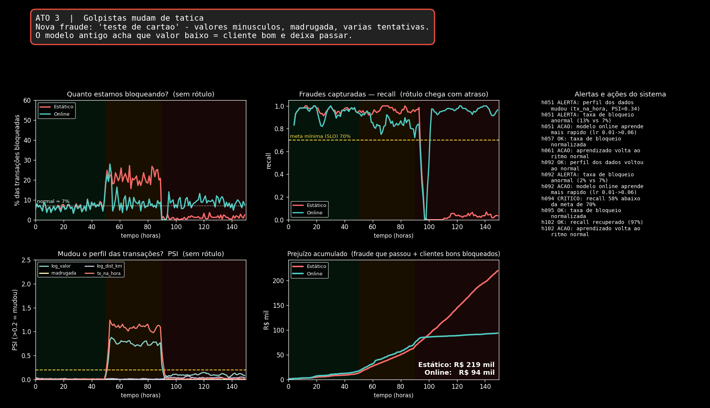

# Observabilidade em ML e Atualização Online de Modelos

Trabalho da disciplina de **Aprendizado de Máquina** (UFRN) · Autor: **Leandro Eloi de Oliveira**

Este projeto demonstra, com uma simulação, **o que acontece com um modelo de machine learning depois que ele vai para produção** e como a **observabilidade** e a **atualização online** ajudam a mantê-lo confiável.

> ⚠️ Todos os dados são **simulados**, com números inventados, apenas para fins didáticos.

---

## 💡 A ideia em poucas palavras

Um modelo de ML **pode piorar em silêncio**: ele continua respondendo, só que errado, porque o mundo muda e ele aprendeu com dados do passado.

- **Observabilidade** = enxergar o que o modelo está fazendo em produção (dados, previsões, qualidade, sistema).
- **Atualização online** = o modelo aprende aos poucos, a cada lote de dados novos, sem recomeçar o treino do zero.
- **Juntas:** a observabilidade **detecta** que algo mudou e a atualização online **corrige**.

### Conceitos abordados
| Conceito | Resumo |
|---|---|
| **Data drift** | Mudam os dados de entrada (ex.: Black Friday) |
| **Concept drift** | Muda a regra do problema (ex.: golpistas mudam de tática) |
| **PSI** (*Population Stability Index*) | Compara a distribuição dos dados de hoje com a do treino; não precisa de rótulo |
| **Sinais sem rótulo × com rótulo** | PSI e taxa de bloqueio são rápidos; recall e prejuízo são confiáveis, mas chegam atrasados |
| **`partial_fit`** | Aprendizado incremental do scikit-learn, usado pelo modelo online |
| **SLO** | Meta mínima de qualidade (aqui: recall ≥ 70%) que dispara alertas |

---

## 🏦 O cenário da demonstração

Um **banco** usa um modelo para bloquear transações suspeitas de cartão de crédito. Dois modelos recebem **exatamente as mesmas transações** durante 150 horas simuladas:

- 🔴 **Estático:** treinado uma vez e nunca mais atualizado.
- 🟢 **Online:** aprende com cada lote assim que os rótulos (chargebacks, com 4 h de atraso) chegam.

A história tem **3 atos**:

| Ato | Horas | O que acontece | Tipo de mudança |
|---|---|---|---|
| 1. Dia normal | 0–50 | Tudo funciona | — |
| 2. Black Friday | 50–90 | Clientes compram mais, mais caro e mais rápido; **a fraude é a mesma** | Data drift |
| 3. Golpistas mudam de tática | 90–150 | "Teste de cartão": valores minúsculos, de madrugada, várias tentativas | Concept drift |

### O que é monitorado
1. **Taxa de bloqueio** (sem rótulo) — rápida
2. **PSI por característica** (sem rótulo) — rápida
3. **Recall** de fraudes (com rótulo, atrasado) — lenta, mas é a verdade
4. **Prejuízo acumulado em R$** — métrica de negócio

Quando um alerta dispara, o modelo online **aprende mais rápido por 10 horas** (atualização disparada por alerta).

---

## 📊 Resultado



| | 🔴 Estático | 🟢 Online |
|---|---|---|
| Prejuízo acumulado | R$ 219 mil | R$ 94 mil |
| Recall na fraude nova | ~0% | volta a ~97% |
| Bloqueios na Black Friday | sobe para ~20% | volta ao normal |

**Economia de ~57%.** O PSI avisou na hora 51 (sem rótulo); o recall só confirmou o problema da fraude nova na hora 94 (com rótulo, atrasado); o modelo online se corrigiu sozinho.

> **Lição:** a observabilidade avisa que algo mudou; a atualização online corrige.

---

## 📁 Estrutura do projeto

| Arquivo | Descrição |
|---|---|
| [`demo_fraude.py`](demo_fraude.py) | Dashboard **ao vivo** da simulação, com botão **Reiniciar** (ou tecla `R`) |
| [`demo_fraude.ipynb`](demo_fraude.ipynb) | Notebook com a simulação completa e os 4 gráficos explicados |
| [`explicacao_simulacao.ipynb`](explicacao_simulacao.ipynb) | Notebook que **descreve passo a passo** como a simulação funciona (dados, modelos, rótulo atrasado, alertas, limitações) |
| [`dashboard_fraude.png`](dashboard_fraude.png) | Imagem final do dashboard |
| [`requirements.txt`](requirements.txt) | Dependências |

---

## ▶️ Como executar

**Requisitos:** Python 3.9+

```bash
pip install -r requirements.txt
```

**Dashboard ao vivo** (abre uma janela e roda a simulação em ~25 s):
```bash
python demo_fraude.py                # padrão
python demo_fraude.py --speed 0.3    # mais lento
python demo_fraude.py --headless     # sem janela; salva dashboard_fraude.png
```
Na janela: botão **↻ Reiniciar** ou a tecla `R` recomeçam a simulação.

**Notebooks:**
```bash
jupyter notebook demo_fraude.ipynb
jupyter notebook explicacao_simulacao.ipynb
```
Execute as células de cima para baixo (`Shift+Enter`).

---

## ⚙️ Como funciona (resumo)

A cada hora simulada:
1. Chegam 250 compras novas.
2. Os dois modelos decidem bloquear ou não (regressão logística treinada com `SGDClassifier`).
3. Medem-se os sinais **sem rótulo** (PSI e taxa de bloqueio).
4. Os rótulos chegam 4 horas depois: mede-se o **recall** e o modelo **online** aprende com `partial_fit`.
5. Regras de alerta são avaliadas e, se disparam, o modelo online aprende mais rápido por um tempo.

Os parâmetros do cenário (duração, momento do drift, atraso do rótulo, custos, metas) ficam no topo de `demo_fraude.py` e na primeira célula dos notebooks.

---

## ⚠️ Limitações

- Dados **gerados por regras simples**, não reais.
- Drift **abrupto** e com hora marcada (na prática costuma ser gradual).
- Rótulos **sempre chegam**, com atraso fixo (na prática, o atraso varia e alguns nunca chegam).
- Modelo **linear simples**; custos em R$ **inventados**.
- Não há etapa de validação antes da atualização (em produção usam-se *shadow mode*, *canary* e *rollback*).

---

## 📚 Referências

- Gama et al. (2014). *A survey on concept drift adaptation.* ACM Computing Surveys.
- Sculley et al. (2015). *Hidden Technical Debt in Machine Learning Systems.* NeurIPS.
- Bifet & Gavaldà (2007). *Learning from Time-Changing Data with Adaptive Windowing.*
- Montiel et al. (2021). *River: machine learning for streaming data in Python.* JMLR.
- Documentação do scikit-learn: *Strategies to scale computationally: bigger data* (`partial_fit`).
